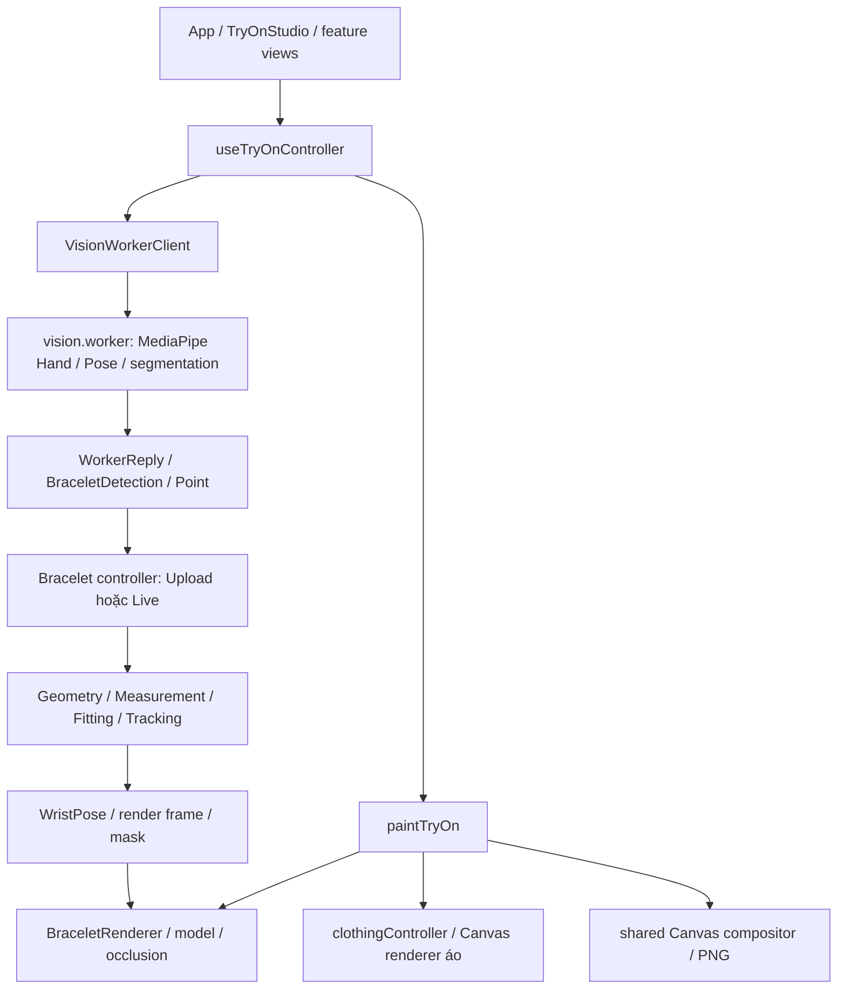

# Kiến trúc Mira sau migration MVC + Feature-Based

Đợt này chỉ tổ chức lại source, tách trách nhiệm và chuẩn hóa comment. Không sửa thuật toán Auto Fit, tracking, orientation, hình học Lumière, material/PBR, ánh sáng, camera hay occlusion. Những hạn chế CV đã có trước migration vẫn còn và cần xử lý ở task riêng.

Triển khai sau khi người dùng đồng ý phương án và yêu cầu tiếp tục. Không tạo commit, không reset/clean Git, không khôi phục đè các thay đổi có trước.

## Bản sao an toàn và phạm vi

Checkpoint trước khi sửa: `backups/pre-mvc-20261122T041227Z/project-state.zip`, kèm `manifest.json` SHA-256, `git-status.txt` và `worktree.diff`. Bao gồm 97 file source, test, tài liệu, config, script và model/WASM; không chứa `node_modules`, `.git`, `dist`, `artifacts` hoặc backup lồng nhau. ZIP đã kiểm tra CRC. Bản này chứa cả thay đổi chưa commit trước migration. Khi cần đối chiếu, giải nén sang thư mục khác, không giải nén đè dự án.

Đã mapping đủ **56 file source cũ** sang **91 file hiện tại** (90 TypeScript/TSX và một CSS), bao gồm 17 file unit test và hai fixture. Mapping JSON ở `artifacts/mvc/final-mapping.json`.

## Cây source thực tế

```text
src/
├── app/
│   ├── controllers/
│   │   ├── controllerBindings.ts
│   │   ├── useTheme.ts
│   │   └── useTryOnController.ts
│   ├── models/
│   │   └── catalog.ts
│   ├── services/
│   │   ├── VisionWorkerClient.ts
│   │   ├── paintTryOn.ts
│   │   └── tryOnRuntime.ts
│   ├── styles/
│   │   └── global.css
│   ├── views/
│   │   ├── AppHeader.tsx
│   │   ├── HelpDialog.tsx
│   │   └── TryOnStudio.tsx
│   ├── workers/
│   │   ├── vision.protocol.ts
│   │   └── vision.worker.ts
│   └── App.tsx
├── features/
│   ├── bracelet/
│   │   ├── controllers/
│   │   │   ├── braceletController.ts
│   │   │   ├── braceletRuntime.ts
│   │   │   ├── liveBraceletController.ts
│   │   │   └── uploadBraceletController.ts
│   │   ├── models/
│   │   │   ├── braceletDimensions.ts
│   │   │   ├── braceletRenderFrame.ts
│   │   │   ├── fitting.types.ts
│   │   │   ├── imageCoordinates.ts
│   │   │   ├── liveContinuity.ts
│   │   │   ├── tracking.types.ts
│   │   │   ├── vision.types.ts
│   │   │   └── wrist.types.ts
│   │   ├── services/
│   │   │   ├── diagnostics/
│   │   │   │   ├── livePerformance.ts
│   │   │   │   ├── sizingDebug.ts
│   │   │   │   └── wristDiagnostics.ts
│   │   │   ├── fitting/
│   │   │   │   ├── braceletSizing.ts
│   │   │   │   └── imageWristRegistration.ts
│   │   │   ├── geometry/
│   │   │   │   └── wristGeometry.ts
│   │   │   ├── live/
│   │   │   │   ├── liveForearmContour.ts
│   │   │   │   ├── liveForearmPose.ts
│   │   │   │   ├── liveFrameBuffer.ts
│   │   │   │   ├── liveFrameClock.ts
│   │   │   │   ├── liveTaskBudget.ts
│   │   │   │   ├── liveVision.ts
│   │   │   │   ├── liveWristFrame.ts
│   │   │   │   ├── liveWristSizing.ts
│   │   │   │   └── liveWristTracking.ts
│   │   │   ├── measurement/
│   │   │   │   ├── foregroundClassifier.ts
│   │   │   │   ├── imageWristMeasurement.ts
│   │   │   │   ├── segmentedWristMeasurement.ts
│   │   │   │   └── wristBoundaryMeasurement.ts
│   │   │   └── tracking/
│   │   │       ├── WristFilter.ts
│   │   │       ├── trackingPolicy.ts
│   │   │       └── wristRoiTracking.ts
│   │   ├── tests/
│   │   │   ├── fixtures/
│   │   │   │   ├── renderScenarios.ts
│   │   │   │   └── wristFixtures.ts
│   │   │   ├── braceletModel.test.ts
│   │   │   ├── braceletRenderFrame.test.ts
│   │   │   ├── braceletSizing.test.ts
│   │   │   ├── dynamicAutoFit.test.ts
│   │   │   ├── forearm.test.ts
│   │   │   ├── imageWristMeasurement.test.ts
│   │   │   ├── liveContinuity.test.ts
│   │   │   ├── liveForearm.test.ts
│   │   │   ├── livePerformance.test.ts
│   │   │   ├── liveWrist.test.ts
│   │   │   ├── segmentedWristMeasurement.test.ts
│   │   │   ├── sessionFit.test.ts
│   │   │   ├── tracking.test.ts
│   │   │   ├── uploadImage.test.ts
│   │   │   ├── wrist.test.ts
│   │   │   └── wristMeasurement.test.ts
│   │   └── views/
│   │       ├── debug/
│   │       │   ├── TrackingDebugPanel.tsx
│   │       │   ├── liveForearmDebug.ts
│   │       │   └── wristDebug.ts
│   │       ├── rendering/
│   │       │   ├── braceletModel.ts
│   │       │   ├── braceletRenderer.ts
│   │       │   └── imageOcclusion.ts
│   │       ├── BraceletArt.tsx
│   │       ├── BraceletControls.tsx
│   │       ├── HandOutline.tsx
│   │       └── trackingMessages.ts
│   └── clothing/
│       ├── controllers/
│       │   └── clothingController.ts
│       ├── models/
│       │   └── clothingGeometry.ts
│       ├── tests/
│       │   └── clothingGeometry.test.ts
│       └── views/
│           ├── rendering/
│           │   └── clothingRenderer.ts
│           ├── ClothingArt.tsx
│           └── ClothingControls.tsx
├── shared/
│   ├── browser/
│   │   └── exportFile.ts
│   ├── canvas/
│   │   └── canvasCompositor.ts
│   ├── media/
│   │   ├── cameraSession.ts
│   │   └── imageInput.ts
│   ├── types/
│   │   ├── tryOn.ts
│   │   └── vision.ts
│   └── ui/
│       ├── CameraToolbar.tsx
│       └── CameraViewport.tsx
└── main.tsx
```

Ngoài `src/`: `public/` giữ model/WASM/favicon; `scripts/prepare-assets.mjs` giữ nhiệm vụ chuẩn bị model; `scripts/run-unit-tests.mjs` tìm test theo feature; `scripts/check-architecture.mjs` kiểm tra dependency; `tests/browser/` chứa kiểm thử trình duyệt; `docs/` chứa báo cáo; `artifacts/` chứa kết quả chạy tại máy và không đưa vào Git.

## Luồng xử lý và ranh giới



- **Model:** DTO và phép tính thuần, hằng số hình học. Không import controller, renderer hay thuật toán có trạng thái từ service. `imageCoordinates.ts` và `braceletRenderFrame.ts` là phép biến đổi dữ liệu thuần.
- **View:** UI React, SVG, debug canvas và renderer. Three.js là bộ hiển thị nên nằm tại `views/rendering/`; công thức hình học/scale vẫn ở model/service tương ứng. Không thay chất lượng sản phẩm khi tách file.
- **Controller:** điều phối dữ liệu và vòng đời, không chuyển công thức AI vào React. `useTryOnController.ts` vẫn export `useTryOn`, giữ API cho view. State React vẫn ở các chủ sở hữu cũ; không thêm thư viện state.
- **Service:** thuật toán đo ảnh, fitting, lọc, ROI, lịch frame, telemetry. Upload và Live có controller riêng nhưng dùng chung phép đo khi trước đây đã dùng chung.
- **Application:** kết hợp hai feature, Worker transport/protocol và vòng đời phiên. Worker dùng static `new URL('../workers/vision.worker.ts', import.meta.url)` để Vite đóng gói; đường dẫn model/WASM giữ nguyên.
- **Shared:** media input, export file, compositor, DTO và UI thực sự dùng chung. Không import ngược vào app hoặc feature.

Dependency đi từ app xuống feature/shared. Feature không import app hoặc feature khác. Model không import service/controller/view. Hai loại cạnh runtime và type đều được kiểm tra vòng lặp; không dựa vào barrel export để che vòng import.

Bốn file phụ trợ được làm rõ trong lúc tách, ngoài danh sách tên dự kiến: `controllerBindings.ts` định nghĩa giao diện callback của app; `tryOnRuntime.ts` ghép runtime của phiên; `braceletRuntime.ts` sở hữu state/callback của vòng; `paintTryOn.ts` điều phối composition hai feature. Chúng giúp feature không cần import ngược app, giữ một bộ generation/pending, không nhân bản nguồn state hoặc đổi thuật toán.

## Tìm phần cần bảo trì

| Nghiệp vụ | Vị trí hiện tại |
| --- | --- |
| Nhận diện Hand/Pose/segmentation | `src/app/workers/vision.worker.ts` |
| Protocol và bitmap/timestamp | `src/app/workers/vision.protocol.ts`, `src/app/services/VisionWorkerClient.ts` |
| Upload: fallback pose, đo ảnh, calibration | `src/features/bracelet/controllers/uploadBraceletController.ts` |
| Live: cập nhật pose, frame acquisition/render, telemetry | `src/features/bracelet/controllers/liveBraceletController.ts` |
| Phân tích cổ tay và orientation | `src/features/bracelet/services/geometry/wristGeometry.ts`, `services/live/liveForearmPose.ts` |
| Đo đường biên pixel | `src/features/bracelet/services/measurement/` |
| Auto Fit / Manual Fit | `src/features/bracelet/services/fitting/`, `models/braceletDimensions.ts` |
| Temporal filtering / ROI | `src/features/bracelet/services/tracking/` |
| Mesh, PBR, camera, occlusion | `src/features/bracelet/views/rendering/` |
| Hình học, điều phối và Canvas áo | `src/features/clothing/` |
| Chế độ sáng/tối | `src/app/controllers/useTheme.ts`, `app/styles/global.css`, bootstrap trong `index.html` |

Tên trong tài liệu lịch sử phản ánh source tại thời điểm viết. Dùng bảng dưới để tìm file mới; không diễn giải báo cáo cũ thành kết quả kiểm thử mới.

## Mapping toàn bộ source cũ → mới

Cột rủi ro đánh giá nguy cơ migration, không phải lỗi đã phát hiện. Với module tách nhỏ, các đích đã liệt kê đầy đủ.

| STT | File cũ | File mới | Vai trò | Thao tác | Lý do | Rủi ro |
| --- | --- | --- | --- | --- | --- | --- |
| 1 | `src/App.tsx` | `src/app/App.tsx`<br>`src/app/controllers/useTheme.ts`<br>`src/app/models/catalog.ts`<br>`src/app/views/AppHeader.tsx`<br>`src/app/views/HelpDialog.tsx`<br>`src/app/views/TryOnStudio.tsx`<br>`src/features/bracelet/views/BraceletControls.tsx`<br>`src/features/bracelet/views/debug/TrackingDebugPanel.tsx`<br>`src/features/clothing/views/ClothingControls.tsx`<br>`src/shared/ui/CameraViewport.tsx`<br>`src/shared/ui/CameraToolbar.tsx` | Vỏ ứng dụng, state sản phẩm; tách giao diện và theme | Tách file | Giảm trách nhiệm mỗi module; giữ code thuật toán | Cao |
| 2 | `src/ProductArt.tsx` | `src/features/bracelet/views/BraceletArt.tsx`<br>`src/features/bracelet/views/HandOutline.tsx`<br>`src/features/clothing/views/ClothingArt.tsx` | Đồ họa SVG riêng vòng tay và áo | Tách file | Giảm trách nhiệm mỗi module; giữ code thuật toán | Trung bình |
| 3 | `src/braceletDimensions.ts` | `src/features/bracelet/models/braceletDimensions.ts` | Hằng số hình học; chuyển đổi Manual Fit và scale | Di chuyển/đổi tên | Đặt cạnh nghiệp vụ và cập nhật import | Thấp |
| 4 | `src/braceletModel.test.ts` | `src/features/bracelet/tests/braceletModel.test.ts` | Unit test giữ nguyên assertion | Di chuyển/đổi tên | Đặt cạnh nghiệp vụ và cập nhật import | Thấp |
| 5 | `src/braceletModel.ts` | `src/features/bracelet/views/rendering/braceletModel.ts` | Mesh bangle, vật liệu PBR, ánh sáng, depth proxy, camera | Di chuyển/đổi tên | Đặt cạnh nghiệp vụ và cập nhật import | Trung bình |
| 6 | `src/braceletRenderFrame.test.ts` | `src/features/bracelet/tests/braceletRenderFrame.test.ts` | Unit test giữ nguyên assertion | Di chuyển/đổi tên | Đặt cạnh nghiệp vụ và cập nhật import | Thấp |
| 7 | `src/braceletRenderFrame.ts` | `src/features/bracelet/models/braceletRenderFrame.ts` | Giữ trách nhiệm xử lý hiện có, chuyển vào feature phù hợp | Di chuyển/đổi tên | Đặt cạnh nghiệp vụ và cập nhật import | Thấp |
| 8 | `src/braceletRenderer.ts` | `src/features/bracelet/views/rendering/braceletRenderer.ts` | Three.js renderer và vòng đời tài nguyên GPU | Di chuyển/đổi tên | Đặt cạnh nghiệp vụ và cập nhật import | Trung bình |
| 9 | `src/braceletSizing.test.ts` | `src/features/bracelet/tests/braceletSizing.test.ts` | Unit test giữ nguyên assertion | Di chuyển/đổi tên | Đặt cạnh nghiệp vụ và cập nhật import | Thấp |
| 10 | `src/braceletSizing.ts` | `src/features/bracelet/models/fitting.types.ts`<br>`src/features/bracelet/services/fitting/braceletSizing.ts`<br>`src/features/bracelet/services/measurement/wristBoundaryMeasurement.ts`<br>`src/features/bracelet/services/diagnostics/sizingDebug.ts` | DTO fit, đo biên, tính fit và số liệu debug | Tách file | Giảm trách nhiệm mỗi module; giữ code thuật toán | Trung bình |
| 11 | `src/draw.ts` | `src/features/clothing/views/rendering/clothingRenderer.ts` | Vẽ lớp phủ áo bằng Canvas | Di chuyển/đổi tên | Đặt cạnh nghiệp vụ và cập nhật import | Thấp |
| 12 | `src/dynamicAutoFit.test.ts` | `src/features/bracelet/tests/dynamicAutoFit.test.ts` | Unit test giữ nguyên assertion | Di chuyển/đổi tên | Đặt cạnh nghiệp vụ và cập nhật import | Thấp |
| 13 | `src/forearm.test.ts` | `src/features/bracelet/tests/forearm.test.ts` | Unit test giữ nguyên assertion | Di chuyển/đổi tên | Đặt cạnh nghiệp vụ và cập nhật import | Thấp |
| 14 | `src/geometry.test.ts` | `src/features/clothing/tests/clothingGeometry.test.ts` | Unit test giữ nguyên assertion | Di chuyển/đổi tên | Đặt cạnh nghiệp vụ và cập nhật import | Thấp |
| 15 | `src/geometry.ts` | `src/features/clothing/models/clothingGeometry.ts` | Hình học placement áo và làm mượt điểm Pose | Di chuyển/đổi tên | Đặt cạnh nghiệp vụ và cập nhật import | Thấp |
| 16 | `src/imageCoordinates.ts` | `src/features/bracelet/models/imageCoordinates.ts` | Giữ trách nhiệm xử lý hiện có, chuyển vào feature phù hợp | Di chuyển/đổi tên | Đặt cạnh nghiệp vụ và cập nhật import | Thấp |
| 17 | `src/imageOcclusion.ts` | `src/features/bracelet/views/rendering/imageOcclusion.ts` | Ghép mask foreground với depth rendering | Di chuyển/đổi tên | Đặt cạnh nghiệp vụ và cập nhật import | Trung bình |
| 18 | `src/imageWristMeasurement.test.ts` | `src/features/bracelet/tests/imageWristMeasurement.test.ts` | Unit test giữ nguyên assertion | Di chuyển/đổi tên | Đặt cạnh nghiệp vụ và cập nhật import | Thấp |
| 19 | `src/imageWristMeasurement.ts` | `src/features/bracelet/services/measurement/imageWristMeasurement.ts` | Giữ trách nhiệm xử lý hiện có, chuyển vào feature phù hợp | Di chuyển/đổi tên | Đặt cạnh nghiệp vụ và cập nhật import | Thấp |
| 20 | `src/imageWristRegistration.ts` | `src/features/bracelet/services/fitting/imageWristRegistration.ts` | Giữ trách nhiệm xử lý hiện có, chuyển vào feature phù hợp | Di chuyển/đổi tên | Đặt cạnh nghiệp vụ và cập nhật import | Thấp |
| 21 | `src/liveContinuity.test.ts` | `src/features/bracelet/tests/liveContinuity.test.ts` | Unit test giữ nguyên assertion | Di chuyển/đổi tên | Đặt cạnh nghiệp vụ và cập nhật import | Thấp |
| 22 | `src/liveContinuity.ts` | `src/features/bracelet/models/liveContinuity.ts` | Giữ trách nhiệm xử lý hiện có, chuyển vào feature phù hợp | Di chuyển/đổi tên | Đặt cạnh nghiệp vụ và cập nhật import | Thấp |
| 23 | `src/liveForearm.test.ts` | `src/features/bracelet/tests/liveForearm.test.ts` | Unit test giữ nguyên assertion | Di chuyển/đổi tên | Đặt cạnh nghiệp vụ và cập nhật import | Thấp |
| 24 | `src/liveForearmContour.ts` | `src/features/bracelet/models/wrist.types.ts`<br>`src/features/bracelet/services/live/liveForearmContour.ts` | Giữ trách nhiệm xử lý hiện có, chuyển vào feature phù hợp | Tách file | Giảm trách nhiệm mỗi module; giữ code thuật toán | Trung bình |
| 25 | `src/liveForearmDebug.ts` | `src/features/bracelet/views/debug/liveForearmDebug.ts` | Giữ trách nhiệm xử lý hiện có, chuyển vào feature phù hợp | Di chuyển/đổi tên | Đặt cạnh nghiệp vụ và cập nhật import | Thấp |
| 26 | `src/liveForearmPose.ts` | `src/features/bracelet/models/wrist.types.ts`<br>`src/features/bracelet/services/live/liveForearmPose.ts` | Giữ trách nhiệm xử lý hiện có, chuyển vào feature phù hợp | Tách file | Giảm trách nhiệm mỗi module; giữ code thuật toán | Trung bình |
| 27 | `src/liveForeground.ts` | `src/features/bracelet/services/measurement/foregroundClassifier.ts` | Phân loại foreground được dùng trong phép đo | Di chuyển/đổi tên | Đặt cạnh nghiệp vụ và cập nhật import | Thấp |
| 28 | `src/liveFrameBuffer.ts` | `src/features/bracelet/services/live/liveFrameBuffer.ts` | Giữ trách nhiệm xử lý hiện có, chuyển vào feature phù hợp | Di chuyển/đổi tên | Đặt cạnh nghiệp vụ và cập nhật import | Thấp |
| 29 | `src/liveFrameClock.ts` | `src/features/bracelet/services/live/liveFrameClock.ts` | Giữ trách nhiệm xử lý hiện có, chuyển vào feature phù hợp | Di chuyển/đổi tên | Đặt cạnh nghiệp vụ và cập nhật import | Thấp |
| 30 | `src/livePerformance.test.ts` | `src/features/bracelet/tests/livePerformance.test.ts` | Unit test giữ nguyên assertion | Di chuyển/đổi tên | Đặt cạnh nghiệp vụ và cập nhật import | Thấp |
| 31 | `src/livePerformance.ts` | `src/features/bracelet/services/diagnostics/livePerformance.ts` | Giữ trách nhiệm xử lý hiện có, chuyển vào feature phù hợp | Di chuyển/đổi tên | Đặt cạnh nghiệp vụ và cập nhật import | Thấp |
| 32 | `src/liveTaskBudget.ts` | `src/features/bracelet/services/live/liveTaskBudget.ts` | Giữ trách nhiệm xử lý hiện có, chuyển vào feature phù hợp | Di chuyển/đổi tên | Đặt cạnh nghiệp vụ và cập nhật import | Thấp |
| 33 | `src/liveVision.ts` | `src/features/bracelet/models/vision.types.ts`<br>`src/features/bracelet/services/live/liveVision.ts` | Giữ trách nhiệm xử lý hiện có, chuyển vào feature phù hợp | Tách file | Giảm trách nhiệm mỗi module; giữ code thuật toán | Trung bình |
| 34 | `src/liveWrist.test.ts` | `src/features/bracelet/tests/liveWrist.test.ts` | Unit test giữ nguyên assertion | Di chuyển/đổi tên | Đặt cạnh nghiệp vụ và cập nhật import | Thấp |
| 35 | `src/liveWristFrame.ts` | `src/features/bracelet/services/live/liveWristFrame.ts` | Giữ trách nhiệm xử lý hiện có, chuyển vào feature phù hợp | Di chuyển/đổi tên | Đặt cạnh nghiệp vụ và cập nhật import | Thấp |
| 36 | `src/liveWristSizing.ts` | `src/features/bracelet/services/live/liveWristSizing.ts` | Giữ trách nhiệm xử lý hiện có, chuyển vào feature phù hợp | Di chuyển/đổi tên | Đặt cạnh nghiệp vụ và cập nhật import | Thấp |
| 37 | `src/liveWristTracking.ts` | `src/features/bracelet/services/live/liveWristTracking.ts` | Giữ trách nhiệm xử lý hiện có, chuyển vào feature phù hợp | Di chuyển/đổi tên | Đặt cạnh nghiệp vụ và cập nhật import | Thấp |
| 38 | `src/main.tsx` | `src/main.tsx` | Bootstrap React, cập nhật import App và CSS | Giữ vị trí, sửa import | Đặt cạnh nghiệp vụ và cập nhật import | Thấp |
| 39 | `src/segmentedWristMeasurement.test.ts` | `src/features/bracelet/tests/segmentedWristMeasurement.test.ts` | Unit test giữ nguyên assertion | Di chuyển/đổi tên | Đặt cạnh nghiệp vụ và cập nhật import | Thấp |
| 40 | `src/segmentedWristMeasurement.ts` | `src/features/bracelet/services/measurement/segmentedWristMeasurement.ts` | Giữ trách nhiệm xử lý hiện có, chuyển vào feature phù hợp | Di chuyển/đổi tên | Đặt cạnh nghiệp vụ và cập nhật import | Thấp |
| 41 | `src/sessionFit.test.ts` | `src/features/bracelet/tests/sessionFit.test.ts` | Unit test giữ nguyên assertion | Di chuyển/đổi tên | Đặt cạnh nghiệp vụ và cập nhật import | Thấp |
| 42 | `src/style.css` | `src/app/styles/global.css` | CSS toàn ứng dụng, giữ nguyên nội dung | Di chuyển/đổi tên | Đặt cạnh nghiệp vụ và cập nhật import | Thấp |
| 43 | `src/testing/renderScenarios.ts` | `src/features/bracelet/tests/fixtures/renderScenarios.ts` | Fixture kiểm thử | Di chuyển/đổi tên | Đặt cạnh nghiệp vụ và cập nhật import | Thấp |
| 44 | `src/testing/wristFixtures.ts` | `src/features/bracelet/tests/fixtures/wristFixtures.ts` | Fixture kiểm thử | Di chuyển/đổi tên | Đặt cạnh nghiệp vụ và cập nhật import | Thấp |
| 45 | `src/tracking.test.ts` | `src/features/bracelet/tests/tracking.test.ts` | Unit test giữ nguyên assertion | Di chuyển/đổi tên | Đặt cạnh nghiệp vụ và cập nhật import | Thấp |
| 46 | `src/types.ts` | `src/features/bracelet/models/wrist.types.ts`<br>`src/shared/types/tryOn.ts`<br>`src/shared/types/vision.ts`<br>`src/app/workers/vision.protocol.ts`<br>`src/features/bracelet/models/vision.types.ts` | Protocol Worker và DTO riêng feature/dùng chung | Tách file | Giảm trách nhiệm mỗi module; giữ code thuật toán | Trung bình |
| 47 | `src/uploadImage.test.ts` | `src/features/bracelet/tests/uploadImage.test.ts` | Unit test giữ nguyên assertion | Di chuyển/đổi tên | Đặt cạnh nghiệp vụ và cập nhật import | Thấp |
| 48 | `src/useTryOn.ts` | `src/app/controllers/useTryOnController.ts`<br>`src/app/controllers/controllerBindings.ts`<br>`src/app/services/tryOnRuntime.ts`<br>`src/app/services/paintTryOn.ts`<br>`src/app/services/VisionWorkerClient.ts`<br>`src/features/bracelet/controllers/braceletController.ts`<br>`src/features/bracelet/controllers/braceletRuntime.ts`<br>`src/features/bracelet/controllers/uploadBraceletController.ts`<br>`src/features/bracelet/controllers/liveBraceletController.ts`<br>`src/features/clothing/controllers/clothingController.ts`<br>`src/shared/media/cameraSession.ts`<br>`src/shared/media/imageInput.ts`<br>`src/shared/browser/exportFile.ts`<br>`src/shared/canvas/canvasCompositor.ts` | Facade React; điều phối Worker, Upload/Live; media, composition và xuất ảnh | Tách file | Giảm trách nhiệm mỗi module; giữ code thuật toán | Cao |
| 49 | `src/vision.worker.ts` | `src/app/workers/vision.worker.ts` | MediaPipe IMAGE/VIDEO, điều phối task và chuyển buffer | Di chuyển/đổi tên | Đặt cạnh nghiệp vụ và cập nhật import | Cao |
| 50 | `src/wrist.test.ts` | `src/features/bracelet/tests/wrist.test.ts` | Unit test giữ nguyên assertion | Di chuyển/đổi tên | Đặt cạnh nghiệp vụ và cập nhật import | Thấp |
| 51 | `src/wristDebug.ts` | `src/features/bracelet/views/debug/wristDebug.ts` | Giữ trách nhiệm xử lý hiện có, chuyển vào feature phù hợp | Di chuyển/đổi tên | Đặt cạnh nghiệp vụ và cập nhật import | Thấp |
| 52 | `src/wristDiagnostics.ts` | `src/features/bracelet/services/diagnostics/wristDiagnostics.ts` | Giữ trách nhiệm xử lý hiện có, chuyển vào feature phù hợp | Di chuyển/đổi tên | Đặt cạnh nghiệp vụ và cập nhật import | Thấp |
| 53 | `src/wristGeometry.ts` | `src/features/bracelet/models/wrist.types.ts`<br>`src/features/bracelet/services/geometry/wristGeometry.ts`<br>`src/features/bracelet/services/tracking/WristFilter.ts` | DTO cổ tay, hình học thuần và bộ lọc thời gian | Tách file | Giảm trách nhiệm mỗi module; giữ code thuật toán | Trung bình |
| 54 | `src/wristMeasurement.test.ts` | `src/features/bracelet/tests/wristMeasurement.test.ts` | Unit test giữ nguyên assertion | Di chuyển/đổi tên | Đặt cạnh nghiệp vụ và cập nhật import | Thấp |
| 55 | `src/wristRoiTracking.ts` | `src/features/bracelet/models/tracking.types.ts`<br>`src/features/bracelet/services/tracking/wristRoiTracking.ts` | ROI tracker và DTO kết quả/khung ảnh | Tách file | Giảm trách nhiệm mỗi module; giữ code thuật toán | Trung bình |
| 56 | `src/wristTracking.ts` | `src/features/bracelet/models/tracking.types.ts`<br>`src/features/bracelet/services/tracking/trackingPolicy.ts`<br>`src/features/bracelet/views/trackingMessages.ts` | Snapshot, chính sách chấp nhận frame và thông báo hiển thị | Tách file | Giảm trách nhiệm mỗi module; giữ code thuật toán | Trung bình |

## Script và kiểm thử

Các `scripts/verify-*.mjs` chuyển tương ứng sang `tests/browser/verify-*.mjs` (giữ tên file). Bốn script Live đã có nhưng chưa được Git track cũng được bảo toàn trong thư mục mới. `verify-clothing.mjs` đưa smoke test áo sẵn có vào lệnh `npm run test:clothing`. Cập nhật npm scripts, giữ nguyên dependencies và lockfile.

`tests/browser/support/sourceModules.mjs` ánh xạ namespace cũ sang URL module dev hiện hành. Hai facade chỉ dành cho browser test (`support/wristGeometry.ts`, `support/braceletSizing.ts`) hỗ trợ test vốn dùng dynamic import các module gộp trước đây; không được app/Worker production import.

```bash
npm run check:architecture
npm test
npm run build
```

Chrome suite cần dev server, chạy tuần tự để tránh tranh tài nguyên và sai số benchmark:

```bash
# Terminal 1
npm run dev
# Terminal 2; nếu Vite chọn cổng khác thì đặt AR_URL tương ứng
npm run test:upload-occlusion
npm run test:live-axis
npm run test:live
npm run test:live-continuity
npm run test:clothing
PERF_TAG=mvc npm run test:live-performance
```

Kiểm tra kiến trúc phát hiện import không tồn tại, phụ thuộc ngược và vòng lặp kể cả import type. Unit runner tìm đệ quy các `.test.ts` trong feature, không bỏ file test cũ.

Một số browser script lịch sử (`test:dynamic`, `test:session` và các kịch bản Upload cũ) còn giả định selector/control Auto Fit hoặc instrumentation của phiên bản UI cũ. Chỉ cập nhật đường dẫn import khi migration, không sửa assertion hoặc thêm lại UI để làm chúng xanh. Không tính các script chưa chạy vào kết quả đã đạt; cần hiện đại hóa riêng theo UI hiện hành.

## Comment tiếng Việt

Đã chuẩn hóa 308 comment/ghi chú tiếng Anh do dự án sở hữu sang tiếng Việt có dấu, giữ thuật ngữ MediaPipe, landmark, quaternion, tracking, occlusion, Auto Fit khi cần. Sửa những ghi chú phạm vi đã lỗi thời, không đổi thuật toán. Không đổi tên hàm/biến/API, chuỗi UI/runtime/log, shader, license, mã vendor/generated, directive như `@vite-ignore` và `/// <reference ...>`.

Comment mới giải thích giả định hình học, đơn vị, lý do reject và vòng đời tài nguyên; tránh kể lại code. Khi thay thuật toán trong task sau, cập nhật comment và test cùng lúc.

## Trình tự migration đã thực hiện

1. Chụp checkpoint và đối chiếu trạng thái Git trước sửa.
2. Di chuyển DTO, model, service, renderer và test; dùng cầu nối tạm để kiểm tra import.
3. Tách hook điều phối, media IO và Worker client; kiểm tra build/unit.
4. Tách UI, theme, feature controls; đối chiếu ảnh UI trước/sau.
5. Chuyển browser suite và xóa cầu nối tạm trong production; kiểm tra dependency và CV replay.
6. Chuẩn hóa comment và tài liệu; lưu bằng chứng đối chiếu thuật toán, assets, UI và kết quả hồi quy.

`vite.config.ts`, `tsconfig.json`, `package-lock.json`, model/WASM và CSS gốc không đổi. `package.json` chỉ đổi script. `index.html` chỉ dịch comment bootstrap theme. Các thay đổi chưa commit có trước được bảo toàn; không dùng Git reset/clean.

## Bằng chứng và giới hạn

Báo cáo máy đọc: `artifacts/mvc/validation.json`. Đối chiếu AST: `artifacts/mvc/algorithm-parity.json`; mapping: `artifacts/mvc/final-mapping.json`; ảnh UI: `artifacts/mvc/ui/`; kết quả Upload và benchmark được liên kết trong validation.

Đối chiếu 83 hàm/class và 43 initializer biến/hằng số bằng AST sau khi bỏ comment và import: bằng nhau. Phạm vi này không bao gồm toàn bộ orchestration/UI, vì chúng được tách; các phần đó được kiểm tra qua browser flow và ảnh UI. Model/WASM/favicon và CSS có SHA-256 giống checkpoint. Bốn ảnh UI trước/sau (vòng sáng/tối, áo sáng, mobile) giống byte.

Các replay dùng MediaPipe thật trên ảnh mẫu chính thức và canvas captureStream, không phải webcam vật lý. Tư thế xoay trong mặt phẳng ảnh và dữ liệu tổng hợp không chứng minh xoay cổ tay 3D trên người thật. Migration không nghiệm thu lại độ vừa/photorealistic và không khắc phục các hạn chế Auto Fit đã báo trước. Cần người dùng xác nhận lại bằng ảnh riêng và webcam thực tế.


Kết quả kiểm tra migration: **190/190 unit test**, TypeScript/build và ranh giới dependency đều qua. Upload tạo lại 15 ảnh PNG A/B/đường đo giống byte với trước migration trên ba fixture. Các suite Live, Live axis, Live continuity và Clothing qua. Live replay cho WebGL khoảng 25,19 fps đứng yên, 22,10 fps chuyển động, 24,49 fps dừng nhanh và 22,33 fps gần/xa, gần mức benchmark trước migration; không có request frame trùng, hàng chờ tối đa một. Đây là phép đo tham khảo, không phải nghiên cứu thống kê có kiểm soát; unit/build có trùng một phần thời gian khởi động benchmark. Các số liệu không chứng minh webcam vật lý hay độ vừa thực tế.
